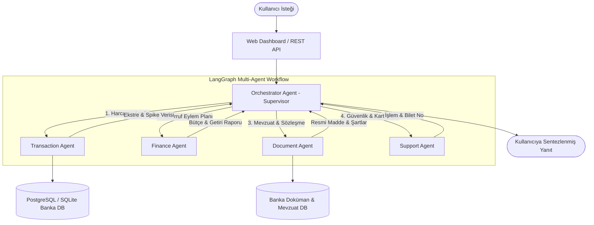

# Multi-Agent Banking Assistant – AI Agent Sistemi

> **LangGraph**, **LangChain**, **FastAPI**, **PostgreSQL** ve **OpenAI API** ile güçlendirilmiş, yeni nesil akıllı bankacılık asistanı.

Bu proje, tek bir genel amaçlı sohbet botu yerine işbirlikçi ve uzmanlaşmış çoklu ajan mimarisi (**Agentic Workflow / Multi-Agent Collaboration**) kullanarak karmaşık bankacılık işlemlerini çözer.

---

## 🏛️ Mimari ve Ajanlar (Agentic Workflow)

Sistem, bir **Orchestrator Agent (Supervisor)** tarafından yönetilen 4 uzman alt ajandan oluşur:



| Ajan | Rol | Görev Tanımı | Kullandığı Tool'lar |
| :--- | :--- | :--- | :--- |
| **Orchestrator Agent** | Supervisor | Kullanıcı niyetini analiz eder, talebi alt görevlere böler, doğru ajanlara yönlendirir ve sonuçları sentezler. | `route_query`, `synthesize_response` |
| **Transaction Agent** | Ledger Analyst | Hesap hareketlerini, geçmiş harcamaları, harcama artışlarını (spikes) ve kategorik sapmaları analiz eder. | `get_customer_transactions`, `analyze_spending_trends` |
| **Finance Agent** | Financial Advisor | Harcama eğilimlerine göre tasarruf stratejileri, 50/30/20 bütçe optimizasyonu ve vadeli faiz getirisi hesaplar. | `calculate_savings_potential`, `get_budget_recommendations` |
| **Document Agent** | Knowledge Specialist | Banka mevzuatları, kredi/kart sözleşmeleri ve PDF dokümanlarından semantik arama ile bilgi getirir. | `search_banking_documents`, `get_banking_document_details` |
| **Support Agent** | Security & Support | Kart dondurma/bloke etme, harcama itirazı (Chargeback) ve destek bileti süreçlerini yönetir. | `block_card`, `create_dispute_ticket`, `check_support_ticket_status` |

---

## 💡 Örnek Akış: "Geçen ay harcamalarım neden arttı ve nasıl tasarruf edebilirim?"

1. **Orchestrator Agent** kullanıcı talebini ayrıştırır:
   - Bölüm A: Harcama artışı analizi -> `Transaction Agent`
   - Bölüm B: Tasarruf önerisi -> `Finance Agent`
2. **Transaction Agent** çalışır:
   - Son 30 günün harcamalarını önceki 30 gün ile kıyaslar.
   - Restoran harcamalarında **+%602 artış** (2,400 TL ➔ 16,850 TL) ve Aboneliklerde **+%239 artış** (2,030 TL ➔ 6,900 TL) olduğunu ve harcamanın yapıldığı başlıca işyerlerini (Nusr-Et, Sunset Grill, MacFit vb.) tespit eder.
3. **Finance Agent** çalışır:
   - Transaction Agent'ın analiz verisini girdi olarak alır.
   - Dışarıda yemek ve abonelik harcamalarını optimize ederek **ayda 9,155 TL**, **yılda 109,860 TL** net tasarruf potansiyeli hesaplar.
   - Bu birikimin bankanın **%45 faizli Vadeli Mevduat Hesabı**'nda değerlendirilmesi halinde 1 yıl sonunda **~134,578 TL** varlığa ulaşılacağını modeller.
4. **Orchestrator Agent** sonuçları sentezleyerek kullanıcıya tek, akıcı ve profesyonel bir bankacılık raporu sunar.

---

## 📁 Proje Dizin Yapısı

```text
├── app/
│   ├── agents/                 # LangGraph çoklu ajan ve supervisor tanımları
│   │   ├── base.py             # LLM yükleme ve test fallback modeli
│   │   ├── orchestrator.py     # Supervisor (yönlendirici ve sentezleyici)
│   │   ├── transaction_agent.py# Harcama ve ekstre analiz ajanı
│   │   ├── finance_agent.py    # Tasarruf ve bütçe danışmanı
│   │   ├── document_agent.py   # Mevzuat ve doküman ajanı
│   │   ├── support_agent.py    # Güvenlik ve müşteri destek ajanı
│   │   └── workflow.py         # LangGraph StateGraph ve MemorySaver
│   ├── api/                    # FastAPI REST API
│   │   ├── routes.py           # /chat, /agents, /transactions, /health
│   │   └── schemas.py          # Pydantic v2 veri modelleri
│   ├── core/                   # Pydantic-Settings yapılandırması
│   ├── db/                     # SQLAlchemy modelleri, session ve tohum verisi
│   ├── models/                 # User, Account, Transaction, DocumentChunk, SupportTicket
│   ├── static/                 # İnteraktif Web UI Dashboard (HTML5, Tailwind, Lucide)
│   ├── tools/                  # Ajanların çağırdığı işlevsel araçlar (Tools)
│   └── main.py                 # FastAPI uygulama giriş noktası
├── tests/                      # Kapsamlı otomatik test süiti (17 test)
├── docker-compose.yml          # PostgreSQL 16 (pgvector) + FastAPI
├── Dockerfile                  # Konteyner imajı
├── requirements.txt            # Python bağımlılıkları
└── README.md
```

---

## 🚀 Hızlı Başlangıç

### Seçenek 1: Yerel Çalıştırma (Python)

1. **Depoyu klonlayın ve dizine girin:**
   ```bash
   git clone https://github.com/iclalsuzann/multi-agent-banking-assistant.git
   cd multi-agent-banking-assistant
   ```

2. **Sanal ortam oluşturun ve bağımlılıkları yükleyin:**
   ```bash
   python -m venv .venv
   # Windows:
   .venv\Scripts\activate
   # Linux / macOS:
   source .venv/bin/activate

   pip install -r requirements.txt
   ```

3. **Ortam değişkenlerini ayarlayın (İsteğe bağlı):**
   ```bash
   cp .env.example .env
   # .env içine OPENAI_API_KEY değerinizi ekleyebilirsiniz
   ```

4. **Uygulamayı başlatın:**
   ```bash
   uvicorn app.main:app --reload --port 8000
   ```
   - 🌐 **Web UI Dashboard:** `http://localhost:8000/`
   - 📑 **Swagger API Dokümantasyonu:** `http://localhost:8000/docs`

---

### Seçenek 2: Docker Compose ile Çalıştırma (PostgreSQL + pgvector)

```bash
docker-compose up --build
```
FastAPI servisi ve PostgreSQL veritabanı otomatik olarak ayağa kalkar, tablolar oluşturulur ve tohum verileri yüklenir.

---

## 🧪 Testlerin Çalıştırılması

Tüm birim, veritabanı, çoklu ajan iş akışı ve API testlerini çalıştırmak için:

```bash
pytest -v tests/
```

Test çıktısı:
```text
tests/test_agents_and_tools.py::test_transaction_tools_and_agent PASSED
tests/test_agents_and_tools.py::test_finance_tools_and_agent PASSED
tests/test_agents_and_tools.py::test_document_tools_and_agent PASSED
tests/test_agents_and_tools.py::test_support_tools_and_agent PASSED
tests/test_api_endpoints.py::test_root_dashboard_and_metadata_endpoints PASSED
tests/test_api_endpoints.py::test_health_check_endpoint PASSED
tests/test_api_endpoints.py::test_list_agents_endpoint PASSED
tests/test_api_endpoints.py::test_transactions_endpoint PASSED
tests/test_api_endpoints.py::test_spending_trends_endpoint PASSED
tests/test_api_endpoints.py::test_chat_composite_query_endpoint PASSED
tests/test_api_endpoints.py::test_chat_support_query_endpoint PASSED
tests/test_db_and_seed.py::test_models_and_relationships PASSED
tests/test_db_and_seed.py::test_seed_database_execution PASSED
tests/test_multi_agent_workflow.py::test_composite_scenario_spending_and_savings PASSED
tests/test_multi_agent_workflow.py::test_document_routing_workflow PASSED
tests/test_multi_agent_workflow.py::test_support_routing_workflow PASSED
tests/test_multi_agent_workflow.py::test_graph_state_isolation_across_threads PASSED

======================= 17 passed in 1.81s =======================
```

---

## 📡 Örnek API İstekleri (cURL)

### 1. Çoklu Ajan Sohbeti (Harcama Analizi & Tasarruf)
```bash
curl -X POST "http://localhost:8000/api/v1/chat" \
     -H "Content-Type: application/json" \
     -d '{
       "query": "Geçen ay harcamalarım neden arttı ve nasıl tasarruf edebilirim?",
       "customer_number": "CUST-1001"
     }'
```

### 2. Kart Bloke Etme Talebi
```bash
curl -X POST "http://localhost:8000/api/v1/chat" \
     -H "Content-Type: application/json" \
     -d '{
       "query": "Kartımı kaybettim, lütfen kartımı bloke edin",
       "customer_number": "CUST-1001"
     }'
```

### 3. Aktif Ajanların Listesini Alma
```bash
curl -X GET "http://localhost:8000/api/v1/agents"
```
